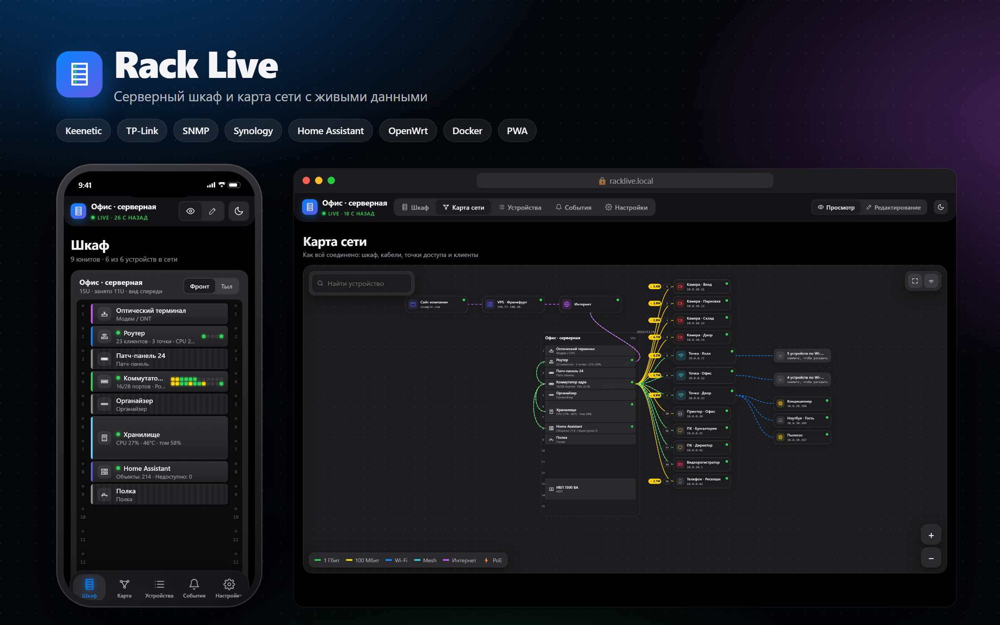
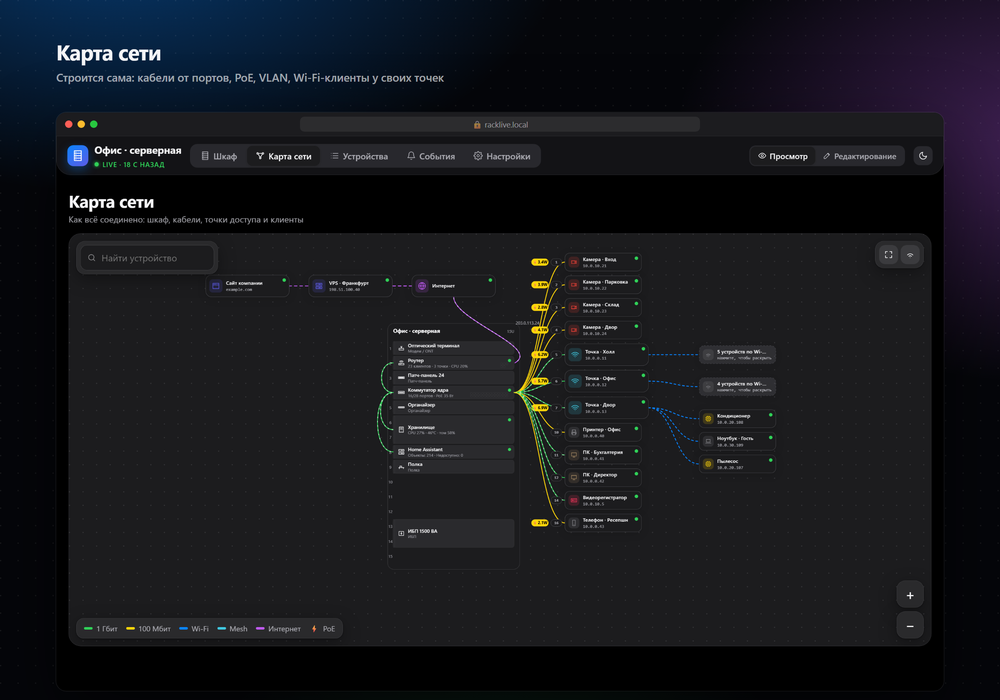
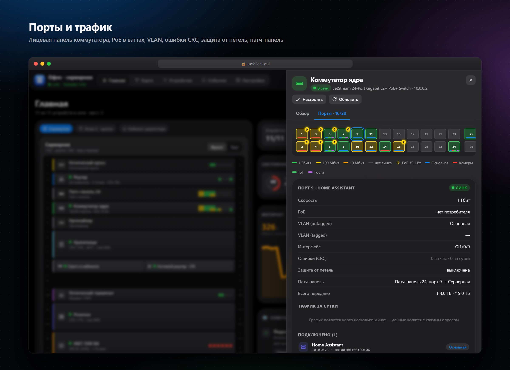
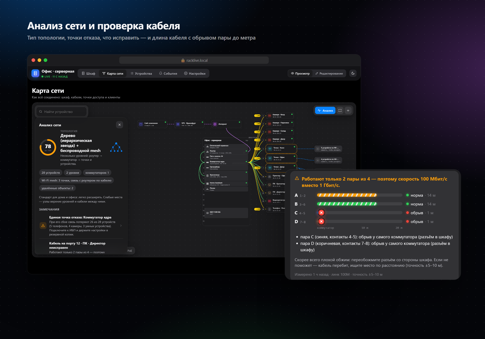
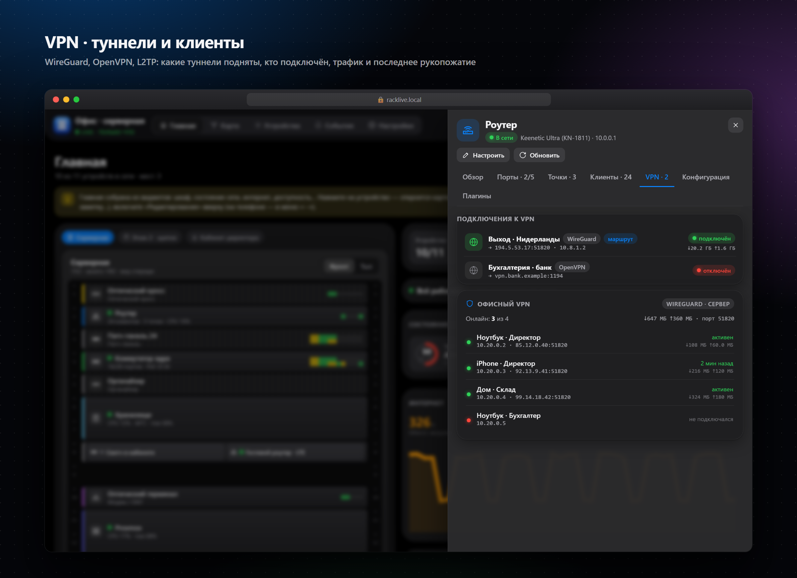
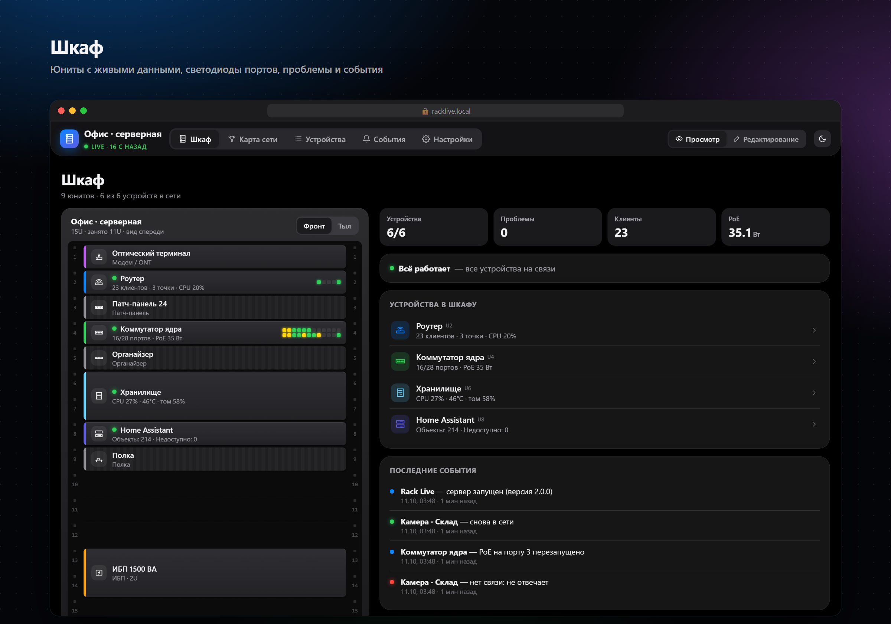
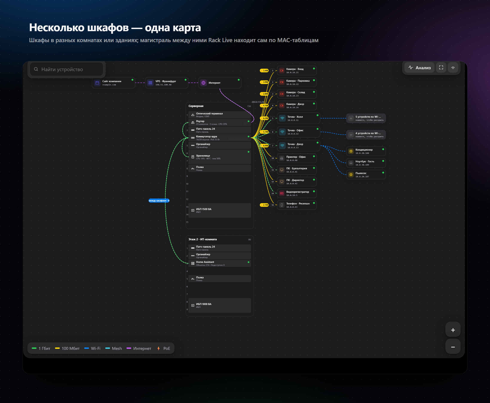
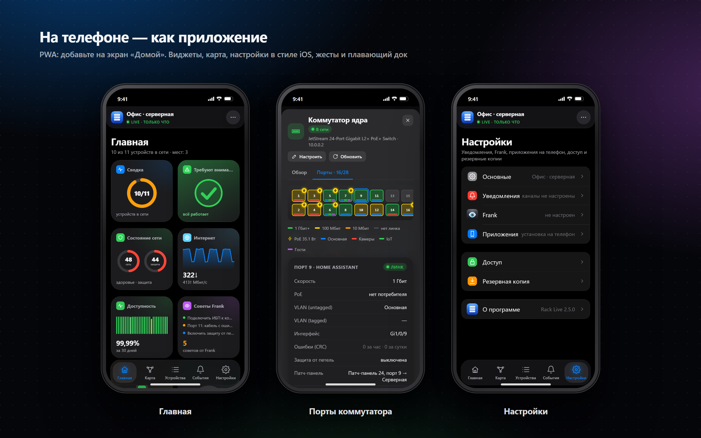
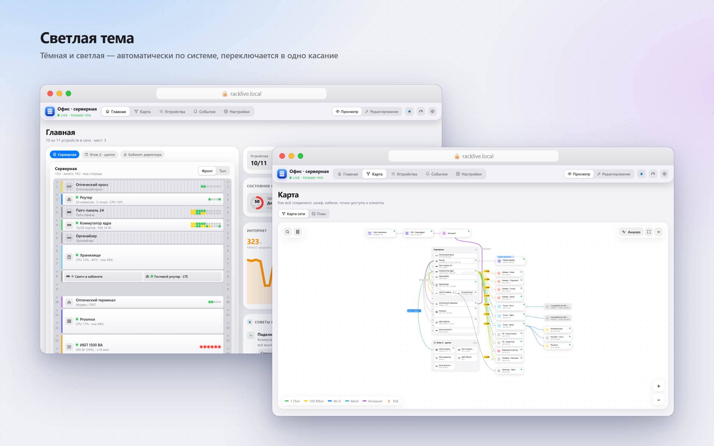

<p align="center"></p>

<h1 align="center">Rack Live</h1>
<p align="center"><b>Серверный шкаф и карта сети с живыми данными.</b><br>
Нарисуйте свой шкаф, добавьте оборудование — Rack Live сам соберёт порты, VLAN, PoE, трафик, клиентов, диски и состояние,<br>
построит карту соединений и покажет, где проблема. Красиво на компьютере и как приложение на телефоне.</p>

<p align="center">


</p>

<p align="center"><a href="#-быстрый-старт">Быстрый старт</a> · <a href="#-попробовать-без-оборудования">Демо</a> · <a href="#-что-умеет">Возможности</a> · <a href="#-поддерживаемое-оборудование">Оборудование</a> · <a href="#-настройка-шаг-за-шагом">Инструкция</a> · <a href="#-вопросы">FAQ</a></p>

---

## ✨ Что умеет

| | |
|---|---|
| 🗄 **Размещение** | Стойка 19″ с юнитами по U, **щиток / настенный бокс** с плитками или **комната**, где всё разбросано — под любую реальность. Живая сводка на каждом юните («17/28 портов · PoE 35 Вт», «CPU 27% · 46°C · том 58%»), светодиоды портов, перетаскивание и обмен местами, фронт и тыл, несколько мест с переключателем. |
| 🏠 **План помещений** | Территория с домами, двором и **столбами**, магистрали между ними (можно указать, через какое волокно кросса идёт). Внутри дома — этажи, комнаты прямоугольником, стены, расстановка шкафов, щитков и устройств с живыми статусами. |
| 🔗 **Патч-панели, оптика, ONT** | Ручная распиновка: какая розетка в какой порт коммутатора (сразу видно линк и кто подключён), волокна кросса с цветом, направлением и затуханием, гнёзда модема/ONT (PON → волокно кросса, LAN → роутер). Связи видны с обеих сторон. |
| 🔋 **ИБП** | Что подключено, сколько потребляет и **на сколько хватит**. Без кабеля данных — расчётом (реальный PoE коммутатора, диски NAS, без двойного счёта), по USB через NUT или по сетевой карте (SNMP) — живые заряд, нагрузка и время. |
| 🕸 **Карта сети** | Строится **сама**: шкаф в центре, кабели от портов к камерам, точкам доступа и серверам, PoE в ваттах, цвет — скорость линка. Wi-Fi-клиенты у своих точек, удалённые объекты — через интернет. **Магистраль между шкафами** находится по MAC-таблицам. Поиск, зум, свои связи. |
| 🔌 **Порты и трафик** | Лицевая панель коммутатора: линк, скорость, PoE, VLAN (untagged / tagged), кто подключён (имя, IP, MAC), график трафика за сутки по каждому порту. |
| 🔐 **VPN** | WireGuard, OpenVPN, L2TP, PPTP, SSTP, IPsec: какие туннели подняты, кто из клиентов онлайн, их адреса и подсети, трафик и когда было последнее рукопожатие. Для роутера-клиента видно, идёт ли маршрутизация через туннель. |
| 🩺 **Анализ сети** | Определяет топологию (звезда, дерево, цепочка, кольцо, mesh, гибрид), находит **единые точки отказа** — «если откажет коммутатор, отвалятся 26 из 28 устройств», — медленные линки, неисправные кабели, слабый Wi-Fi, перегруженные порты. Оценка здоровья 0–100 и что исправить. |
| 📶 **Тест скорости и карта Wi-Fi** | Кнопка-спидометр в шапке: телефон меряет скорость до Rack Live (загрузка, отдача, задержка, джиттер) — **без приложений**. Rack Live сам определяет, к какой точке доступа вы подключены, диапазон и уровень сигнала, и объясняет результат простыми словами. Отметьте место замера на плане — получится **карта покрытия Wi-Fi** по дому и двору. Для серверов — **iperf3** в обе стороны. |
| 🛡 **Безопасность** | Помощник проверяет сеть: пробросы портов и опасные сервисы за ними (RDP, SMB, telnet, базы данных), доступ к роутеру из интернета, UPnP, пароли по умолчанию, telnet и SNMP «public», новые прошивки, истекающие сертификаты. Оценка 0–100, объяснение простыми словами, кнопка **«Исправить»** там, где это безопасно (закрыть проброс, закрыть telnet/SSH роутера из интернета), и «Это нормально» для осознанных исключений. О новых критичных проблемах — уведомление. |
| 🧩 **Плагины** | Дополнения в один клик прямо на устройство. **Keenetic / Netcraze:** Entware (инструкция с автопроверкой), **AWG native** — подключение AmneziaWG из .conf средствами прошивки с маршрутизацией сайтов через туннель, **HydraRoute Neo**, **AWG Manager**. **OpenWrt:** **Forkop** (sing-box extended, XHTTP), **Podkop**, драйверы USB-модемов на выбор. **VPS:** панели **3x-ui** и **Remnawave** — с доменом, сайтом-заглушкой и сертификатом Let's Encrypt, по желанию сразу с инбаундами VLESS TCP + XHTTP и тестовым пользователем. |
| 🔎 **Автоопределение** | При добавлении устройства достаточно ввести адрес — Rack Live сам поймёт, что это: Keenetic, OpenWrt, Synology, Home Assistant, коммутатор TP-Link, SNMP-устройство или Linux-сервер. |
| 🧷 **Ошибки портов** | Счётчики повреждённых кадров (CRC) по каждому порту за час и сутки: кабель может держать 1 Гбит/с и при этом портить кадры — Rack Live это заметит, покажет в анализе сети и пришлёт уведомление. |
| 🧪 **Проверка кабеля** | Встроенный тестер коммутатора: длина кабеля и состояние каждой из 4 пар — обрыв, замыкание, плохой обжим и **на каком метре**. Объясняет по-человечески: «работают только 2 пары — поэтому 100 Мбит/с, переобожмите разъём со стороны шкафа». |
| 📊 **Устройства** | CPU, память, температура с графиками за сутки, диски и тома, Docker-контейнеры, mesh-точки и их клиенты с уровнем сигнала. |
| 🛠 **Управление** | Перезапуск PoE и порта (камера зависла — одна кнопка), перезагрузка роутера и точек, перезапуск контейнеров, выключатели Home Assistant. Только после входа и с подтверждением. |
| 🔔 **Уведомления** | Telegram, почта, ntfy / Home Assistant: устройство пропало, ИБП на батарее, порт упал до 100 Мбит, место кончается, перегрев, VPN не поднят, сертификат истекает — и «восстановилось». Без спама: выдержка, одно сообщение на пачку событий. |
| 📲 **Мини-приложение в Telegram** | Кнопка «Rack Live» в боте и «Открыть» под каждым уведомлением — панель открывается прямо в Telegram, вход по аккаунту без пароля. |
| 📜 **События** | Когда что пропало и вернулось, входы, неудачные попытки входа, действия администратора. |
| 🌍 **Удалённые объекты** | Проверка по ping / порту / сайту (с контролем срока сертификата) и **агент** для серверов за NAT — данные приходят сами, порты открывать не нужно. |
| 📱 **PWA** | На телефоне — как приложение: плавающий док, жесты, тёмная и светлая тема. |
| 🔒 **Безопасно** | Режимы «Просмотр / Редактирование», пароль администратора, пароли устройств никогда не уходят в браузер, защищённые uplink-порты. |
| 🪶 **Лёгкий** | Сервер — только стандартная библиотека Python, интерфейс — один JS-файл. Ни одной внешней зависимости, работает без интернета. |

<p align="center"></p>
<p align="center"></p>
<p align="center"></p>
<p align="center"></p>
<p align="center"></p>
<p align="center"></p>
<p align="center"></p>
<p align="center"></p>

---

## 🚀 Быстрый старт

Нужен любой постоянно включённый компьютер в вашей сети (NAS, мини-ПК, Raspberry Pi, сервер, Proxmox) с **Docker**.

```bash
git clone https://github.com/mikolord/racklive.git
cd racklive
docker compose up -d --build
```

Откройте **`http://<адрес-сервера>:8080`** — Rack Live попросит задать название и пароль администратора. Готово.

<details>
<summary><b>Synology (Container Manager)</b></summary>

1. Центр пакетов → установите **Container Manager**.
2. На этой странице **Code → Download ZIP**, распакуйте в общую папку, например `docker/racklive`.
3. Container Manager → **Проект** → **Создать** → имя `racklive`, путь — папка `docker/racklive` (там лежит `docker-compose.yml`) → **Далее** → **Готово**.
4. Откройте `http://<адрес-NAS>:8080`.
</details>

<details>
<summary><b>Windows / macOS</b></summary>

Установите [Docker Desktop](https://www.docker.com/products/docker-desktop/), затем в папке `racklive`:
```bash
docker compose up -d --build
```
Если Docker Desktop не поддерживает `network_mode: host`, в `docker-compose.yml` уберите эту строку и раскомментируйте `ports`. Всё будет работать, только тест скорости не сможет определить, к какой точке доступа подключён телефон.
</details>

<details>
<summary><b>Без Docker (только Python 3.9+)</b></summary>

```bash
git clone https://github.com/mikolord/racklive.git && cd racklive
python3 -m rackd            # RL_PORT=8080, RL_DATA=./data — можно поменять переменными окружения
```
Для автозапуска оформите как службу systemd / задачу в планировщике.
</details>

### Обновление
```bash
cd racklive && git pull && docker compose up -d --build
```
Ваши настройки лежат в папке `data/` и при обновлении не трогаются.

---

## 🎮 Попробовать без оборудования

Демо-режим запускает выдуманный офис: роутер с mesh-точками, коммутатор с камерами, NAS, Home Assistant, удалённый VPS и сайт. Всё живое, все кнопки нажимаются, но ничего реального не трогается, вход не нужен.

```bash
docker run --rm -p 8080:8080 -e RL_DEMO=1 $(docker build -q .)
```
или без Docker: `RL_DEMO=1 RL_DATA=./data-demo python3 -m rackd`

---

## 🧩 Поддерживаемое оборудование

| Тип | Что собирается | Управление | Что подготовить |
|---|---|---|---|
| **Keenetic / Netcraze** | порты, VLAN, клиенты по сегментам, mesh-точки и их Wi-Fi-клиенты, WAN, KeenDNS, **VPN-туннели и клиенты** | перезагрузка роутера и точек | логин и пароль администратора |
| **TP-Link JetStream** (T2600G, T1600G, SG3xxx) | линк, скорость, PoE по портам, VLAN, кто на каком порту, трафик, ошибки CRC | перезапуск PoE, перезапуск порта, проверка кабеля (длина, пары, место обрыва) | включить **telnet**; для графиков и ошибок — `snmp-server community ИМЯ read-only`; uplink-порт указать в «защищённых» |
| **SNMP — любое устройство** (Cisco, MikroTik, Zyxel, D-Link, HP, Ubiquiti, принтеры, ИБП, Linux) | порты, скорость, подписи, трафик, ошибки CRC, MAC-таблица, VLAN, соседи LLDP, CPU, память, диски | — | включить **SNMP v2c** только для чтения |
| **Synology DSM** | диски, тома, температура, CPU/RAM, сетевые карты, контейнеры | перезапуск контейнера | пользователь **без двухэтапной проверки** |
| **Home Assistant** | версия, объекты, недоступные устройства, выключатели и свет | включить / выключить | Профиль → Безопасность → **долгосрочный токен** |
| **OpenWrt** | модель, прошивка, память, интерфейсы, DHCP-клиенты | перезагрузка | логин root (LuCI / ubus) |
| **Доступность** | онлайн или нет, задержка — для камер, точек, чего угодно | — | IP или домен (и порт, если ping закрыт) |
| **Сайт** | код ответа, время, срок сертификата, наличие текста | — | адрес |
| **Агент** | CPU, память, диски, температура, Docker на любом Linux | — | одна команда на сервере (программа подскажет) |
| **Сервер / VPS по SSH** | CPU, память, диски, температура, ОС, Docker — без установки чего-либо на сервер (Debian, Ubuntu, Alpine, OpenWrt, Synology…) | перезапуск контейнера, перезагрузка, **тест скорости iperf3** | SSH: пароль или приватный ключ; для теста скорости — пакет `iperf3` |
| **ИБП** | нагрузка, заряд, время работы, от сети / от батареи, что подключено | — | без кабеля — ничего; USB → NAS с NUT (порт 3493) или сетевая карта (SNMP) |

> Нет нужного драйвера? Это один файл в `rackd/drivers/` — класс с методом `poll()`, возвращающий словарь в общем формате (описан в `rackd/drivers/__init__.py`). PR приветствуются.

---

## 📖 Настройка шаг за шагом

1. **Первый вход.** Откройте адрес, задайте название (например «Офис») и пароль администратора — от 8 символов.
2. **Добавьте устройства.** Вкладка **Устройства → Добавить** → выберите тип → адрес и логин → **Проверить** (сразу видно, подключилось ли) → **Сохранить**. Через минуту появятся данные.
3. **Опишите, где что стоит.** Вкладка **Размещение** → переключатель **Редактирование** → **+ Место** (стойка, щиток или комната) → нажмите на пустой юнит → название, тип, **связанное устройство** (кнопка «+ Устройство» сразу предложит подходящее подключение; ИБП добавится в «Устройства» сам). Юниты перетаскиваются, на занятое место — меняются местами. У патч-панели, кросса и ONT — кнопка «Распиновка».
4. **План** (необязательно): дома, этажи, двор, столбы, комнаты — и расстановка шкафов и устройств по ним.
5. **Карта сети** строится сама. В режиме редактирования узлы можно двигать и дорисовывать свои связи (например, оптику до соседнего здания).
6. **Настройки** → названия и цвета VLAN, частота опроса, «просмотр без пароля» (схема видна всем, управление — только вам).
7. **На телефоне:** откройте адрес в Safari / Chrome → «Поделиться» → **На экран «Домой»**.
8. **Удалённый сервер:** Устройства → Добавить → **Сервер / VPS по SSH** (ничего ставить не нужно) или **Агент**, если сервер за NAT и до него нельзя достучаться.

### Уведомления в Telegram
1. В Telegram откройте **@BotFather** → `/newbot` → придумайте имя → скопируйте **токен** (`123456:ABC…`).
2. Rack Live → **Настройки → Уведомления → Telegram**: включите, вставьте токен → **«Сохранить»**.
3. Нажмите **«Привязать Telegram»** → откроется ваш бот → **Start**. ID впишется сам — вводить ничего не нужно.
4. **«Отправить тест»** — в боте придёт сообщение.
5. Отметьте справа, о чём сообщать, и поправьте пороги. У отдельного устройства уведомления выключаются в его настройках.
6. Аватарка боту: после привязки бот сам пришлёт картинку с инструкцией (ещё раз — кнопка **«Аватар для бота»**) → @BotFather → `/setuserpic` → выберите бота → перешлите картинку.

**Вход через Telegram.** После привязки на странице входа появится **«Войти через Telegram»**: бот спросит «Вход с адреса … — это вы?», нажимаете «Да» — и вы в панели. Работает и в домашней сети, без домена и https. Подтвердить может только привязанный аккаунт, ссылка одноразовая и живёт 10 минут.

Также доступны почта (SMTP) и webhook — [ntfy](https://ntfy.sh) для push без Telegram или Home Assistant.

### Rack Live прямо в Telegram (мини-приложение)
Telegram открывает мини-приложения только по **https://**, поэтому Rack Live должен быть доступен из интернета:
- **Keenetic / Netcraze:** «Сетевые правила» → **«Доменное имя»** (KeenDNS) → добавить веб-приложение → IP сервера и порт Rack Live → получите `https://rack.<имя>.keenetic.link` с готовым сертификатом;
- **Synology:** Портал входа → Обратный прокси `https://rack.ваш-домен` → `http://localhost:8080`, сертификат Let's Encrypt, проброс 443;
- без белого IP — Cloudflare Tunnel и т. п.

Вставьте адрес в **Настройки → Уведомления → Telegram → «Адрес Rack Live в интернете»** и сохраните: у бота появится кнопка **«Rack Live»**, под уведомлениями — **«Открыть»**. Входят без пароля только разрешённые аккаунты (по умолчанию — те же ID, что получают уведомления). Подпись Telegram проверяется на сервере токеном бота, подделать вход нельзя.

### Доступ из интернета
Не открывайте порт 8080 наружу напрямую. Поставьте Rack Live за HTTPS (nginx / Caddy / Traefik / reverse proxy роутера) или заходите через VPN. За прокси с HTTPS cookie автоматически получает флаг `Secure`.

### Резервная копия
**Настройки → Скачать резервную копию** (устройства с паролями, размещение, карта, план). Или просто копируйте папку `data/`.

---

## ❓ Вопросы

<details><summary><b>Где хранятся пароли от устройств?</b></summary>
В <code>data/config.json</code> на вашем сервере (права 600). В браузер они не передаются никогда, даже администратору — поле пароля можно только перезаписать.</details>

<details><summary><b>Карта нарисовалась не так, как у меня соединено</b></summary>
Карта строится по MAC-таблицам коммутаторов и данным роутера. Если между устройствами стоит неуправляемый коммутатор, он появится узлом «N устройств». Любую связь можно дорисовать вручную в режиме редактирования.</details>

<details><summary><b>Кнопка «Перезапустить PoE» долго выполняется</b></summary>
Так и задумано: питание отключается на ~8 секунд, чтобы устройство гарантированно перезагрузилось, затем включается и проверяется. Камере нужно ещё 1–2 минуты на загрузку — порт будет помечен «Перезагружается…».</details>

<details><summary><b>Как определяется тип топологии и точки отказа?</b></summary>
По графу карты: Rack Live смотрит, сколько уровней распределения (роутер → коммутатор → …), нет ли цепочек коммутаторов и колец, и для каждого узла считает, сколько устройств потеряют связь, если он откажет. Второстепенные роутеры (гостевой портал, роутер арендатора) считаются отдельными сетями, а не обходным путём. Анализ — на карте кнопка <b>«Анализ»</b> и карточка «Здоровье сети» на главной.</details>

<details><summary><b>Насколько точна проверка кабеля?</b></summary>
Длина — ±5–10 м (так меряет сам коммутатор). Обрыв и замыкание пары определяются надёжно. Во время теста связь на порту может пропасть на 3–5 секунд, поэтому тест запускается только вручную и не на защищённых (uplink) портах. На гигабитном линке все 4 пары гарантированно работают — случайные «ошибки» отдельной пары в этом случае отбрасываются.</details>

<details><summary><b>Насколько точно ИБП считает время без кабеля данных?</b></summary>
Это оценка: ёмкость аккумуляторов × ~80% глубины разряда × ~85% КПД, с поправкой на высокую нагрузку. Потребление берётся по типу устройства, а где есть живые данные — точнее: у коммутатора реальный PoE, у NAS — число дисков. Устройство, которое питается по PoE от коммутатора на том же ИБП, второй раз не считается. Для точных цифр подключите ИБП по USB к NAS и включите там сетевой ИБП-сервер (NUT), разрешив адрес Rack Live.</details>

<details><summary><b>Что именно меряет тест скорости?</b></summary>
Скорость между вашим телефоном или компьютером и сервером Rack Live, то есть домашнюю сеть и Wi-Fi, а не интернет. Тест идёт 8 секунд в каждую сторону в 4 потока, первые 1,5 секунды (разгон TCP) не учитываются. Чтобы Rack Live видел, к какой точке доступа вы подключены, он должен видеть настоящий IP телефона: в Docker это <code>network_mode: host</code> (так в <code>docker-compose.yml</code> по умолчанию). Сохранять замеры и отмечать их на плане может администратор. Потолок теста — скорость сетевого порта сервера и его процессора: на слабом NAS это около 500–900 Мбит/с.</details>

<details><summary><b>iperf3: «на устройстве нет iperf3» или «не удалось подключиться»</b></summary>
Тест iperf3 запускает на устройстве временный сервер iperf3 по SSH (на случайном порту 5300–5399, один раз) и подключается к нему из Rack Live. Установите пакет: <code>apt install iperf3</code>, <code>opkg install iperf3</code> (OpenWrt, Entware на Keenetic) или <code>apk add iperf3</code>. Если подключиться не удаётся, разрешите эти порты в файрволе устройства.</details>

<details><summary><b>Плагины что-то ломают? Что они меняют на устройстве?</b></summary>
Каждый плагин перед изменением показывает, что именно сделает, и спрашивает подтверждение, а после — журнал команд. Установщики сторонних проектов (HydraRoute Neo, AWG Manager, Forkop, Podkop, 3x-ui, Remnawave) запускаются официальными скриптами их авторов — ссылка «О проекте» в карточке плагина. AWG native при ошибке убирает всё, что успел создать. Установка панелей на VPS идёт в фоне — окно можно закрыть. Первый раз лучше пробовать на устройстве, которое не жалко.</details>

<details><summary><b>Сколько ресурсов нужно?</b></summary>
~30–60 МБ памяти и доли процента CPU. Работает даже на Raspberry Pi.</details>

---

## 🛠 Разработка

- Сервер: `rackd/` — Python, только стандартная библиотека (`python -m rackd`).
- Интерфейс: React 18 без бандлера. Исходники — `web/src/*.jsx`, сборка — `python build.py` (нужен Node.js; Babel ставится в `web/node_modules` автоматически), результат — `web/app.js`.
- Проверка перед выкладкой: `python tools/smoke.py` — поднимает демо, проверяет API и открывает все вкладки и окна в headless-браузере (Edge / Chrome), падает на любой ошибке интерфейса.
- Скриншоты для README: `docs/showcase/make.html` (собирает картинки из снимков демо-режима).

## Лицензия
[MIT](LICENSE) — используйте, меняйте, делитесь.
