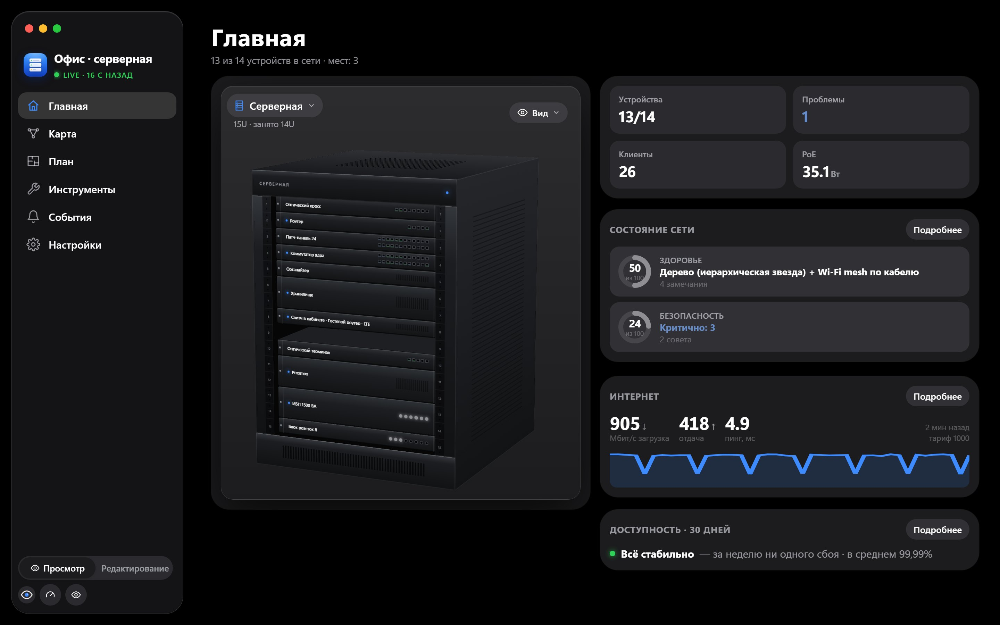
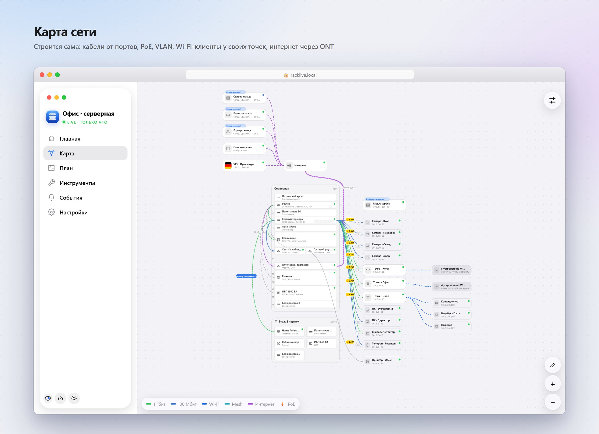
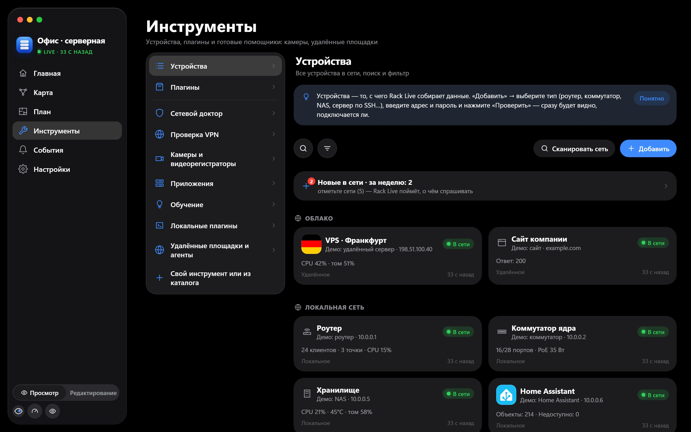
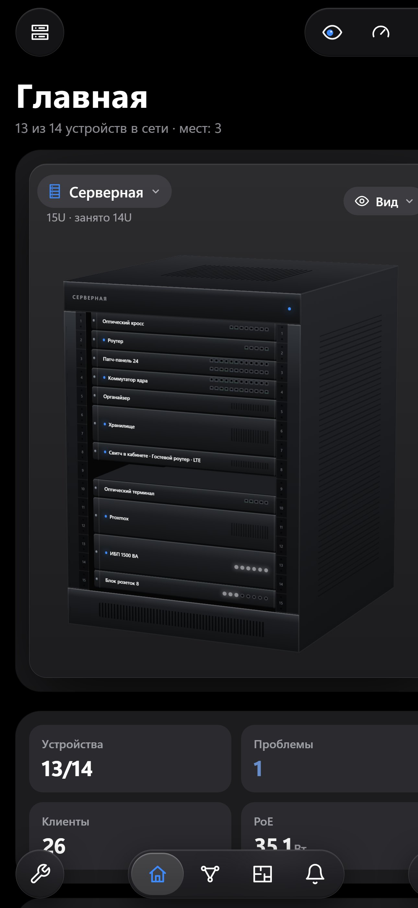
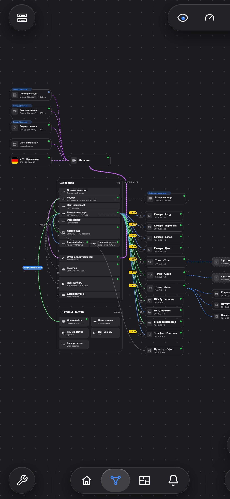

<p align="center"></p>

<h1 align="center">Rack Live</h1>
<p align="center"><b>Серверный шкаф и карта домашней сети с живыми данными.</b><br>
Порты, VLAN, PoE, трафик, камеры, диски, ИБП и проблемы — в одном месте, на компьютере и телефоне.</p>

<p align="center">


</p>

<table>
<tr>
<td width="50%"></td>
<td width="50%"></td>
</tr>
</table>
<p align="center">


</p>

## Что умеет

- **Шкаф и план**: стойка, щиток или комната с живой сводкой на каждом устройстве; план дома по этажам; схема-чертёж с реальными устройствами и их статусами.
- **Карта сети**: роутеры, коммутаторы, точки, клиенты, VPN; скорость и тип каждой связи.
- **Камеры**: поиск по сети, кадр прямо в карточке, пароли списком.
- **Диагностика**: ошибки портов, проверка кабеля, диски (S.M.A.R.T.), Docker, ИБП, интернет.
- **Управление и уведомления**: PoE, порты, перезагрузка; Telegram, почта, ntfy.
- **Помощник Frank** (ИИ), темы оформления, расширения сообщества.

Работает с Keenetic, OpenWrt, TP-Link JetStream, Synology, Proxmox, Home Assistant, любым SNMP-устройством, Linux и Windows по SSH. Нужного нет — драйвер это один файл в `rackd/drivers/`.

## Быстрый старт

Нужен постоянно включённый компьютер с **Docker** (NAS, мини-ПК, Raspberry Pi, сервер).

```bash
git clone https://github.com/mikolord/racklive.git
cd racklive
docker compose up -d --build
```

Откройте `http://<адрес-сервера>:8080` и задайте пароль администратора.

<details>
<summary>Synology, Windows / macOS, роутер, без Docker</summary>

- **Synology**: Container Manager → Проект → Создать, путь к папке с `docker-compose.yml`.
- **Windows / macOS**: Docker Desktop, затем та же команда. Если не работает `network_mode: host`, уберите строку и раскомментируйте `ports`.
- **Роутер** Keenetic (Entware) или OpenWrt: [install/README.md](install/README.md).
- **Без Docker**: `python3 -m rackd` (Python 3.9+; `RL_PORT`, `RL_DATA` — переменные окружения).
</details>

**Обновление:** `git pull && docker compose up -d --build` — настройки в `data/` не трогаются.

**Демо без оборудования:** `docker run --rm -p 8080:8080 -e RL_DEMO=1 $(docker build -q .)` — выдуманный офис, ничего реального не затрагивается.

## Подробнее

[Темы](docs/THEMES.md) · [Контейнерные приложения](docs/CONTAINER_APPS.md) · [Локальные плагины](docs/LOCAL_PLUGINS.md) · остальное — в самой программе (Настройки).

## Разработка

Сервер `rackd/` — Python, только стандартная библиотека. Интерфейс — React 18, исходники `web/src/*.jsx`, сборка `python build.py`. Проверка перед выкладкой: `python tools/smoke.py`.

## Лицензия

[MIT](LICENSE)
